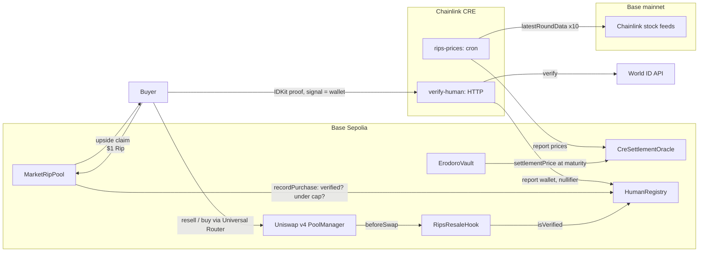

# Erodoro Rips at ETHGlobal Mumbai

**Rips sell the upside of a stock in $1 slices.** A stock holder deposits tokenized stock into Erodoro's vault, which
splits it into a capped claim the holder keeps and an upside claim above today's price + 5%. Buyers pay $1 for a
slice of that upside; at expiry the vault settles at the stock's price and pays out in the stock itself. Real stock
backs every payout.

At ETHGlobal Mumbai we added three things Rips needed, all on **Base Sepolia**:

| Need | Partner | What we built |
|---|---|---|
| Settle at a price nobody at Erodoro can set | **Chainlink CRE** | A workflow that reads Chainlink's stock feeds on Base mainnet and reports them to `CreSettlementOracle`, which the vault settles from. |
| Small inventory shouldn't go to whoever runs the most wallets | **World ID** | `HumanRegistry`: one wallet per human, written by a CRE workflow that checks the proof with World's API. The Rips pool asks it before every sale and caps each person per batch. |
| Rips couldn't be sold before expiry | **Uniswap v4** | A resale pool per Rip (wrapped upside claim vs USDC) behind `RipsResaleHook`, which lets only verified humans trade. |

## How it fits together



## Partner integrations

### Chainlink CRE
- [`cre/rips-prices`](../cre/rips-prices/main.ts): cron trigger → `latestRoundData` on ten Coinbase stock feeds on
  Base mainnet → one report → [`CreSettlementOracle`](../contracts/src/oracle/CreSettlementOracle.sol) on Base
  Sepolia. The oracle keeps every observation, and `settlementPrice` returns the first one at or after maturity
  (feed prints older than 4 days are refused). It implements Erodoro's `IOracleAdapter`, so the vault settles from it
  unchanged.
- [`cre/verify-human`](../cre/verify-human/main.ts): HTTP trigger with a World ID proof → checks action, Proof of
  Human and that the signal is the wallet → World's `/api/v4/verify` through CRE's HTTP capability with consensus →
  report `(wallet, nullifier)` → [`HumanRegistry`](../contracts/src/identity/HumanRegistry.sol).
- Both contracts accept reports only from the Keystone forwarder ([`CreReceiver`](../contracts/src/cre/CreReceiver.sol)).
  While we run on `cre workflow simulate --broadcast`, the forwarder is Chainlink's mock, which relays anything, so
  the receiver also pins the simulation sender. With deploy access, point it at the live `KeystoneForwarder` and
  clear the pin.
- Why it's needed: the stock feeds exist on Base mainnet, not on Base Sepolia; and the house sells Rips, so it must
  not set the price it pays out.

### World ID (IDKit 4) · prize: Best Use of IDKit
- [`HumanCheck`](../app/components/rips/human-check.tsx): `IDKitRequestWidget` for **Proof of Human**, v4 only
  (`allow_legacy_proofs={false}`), with the wallet as the signal. A small verifier
  ([`app/scripts/world-verifier.mjs`](../app/scripts/world-verifier.mjs)) signs the request context and runs the
  CRE workflow; the static app has no server.
- **The trust moment:** buying a Rip. Each batch has about $50 of inventory. Without uniqueness, one buyer with many
  wallets takes it all. `HumanRegistry` counts spend per nullifier, so the per-person cap ($50 per batch, raised
  from $5 so people can buy several Rips) holds across every wallet a person verifies; moving to a new wallet moves
  access but not the allowance, and a banned person can't come back.
- **Why Proof of Human is the minimum:** the property is "one allowance per person". Selfie Check isn't a strict
  one-person-one-account guarantee, and a passport is unique per document, not per person (two passports, two
  allowances). Proof of Human is the only credential unique per human, and it reveals nothing else.
- **Shown on Base Sepolia, by clicks:**
  - Successful verification: the test buyer verified through the CRE workflow
    ([tx](https://sepolia.basescan.org/tx/0x80c74ad65b6e8dcbad4ca05d985b790bd0ab43914e289520f1681d30f906fab4)),
    then bought a $1 Rip and sold its tAAPL claims on Uniswap through the hook
    ([tx](https://sepolia.basescan.org/tx/0xdf8a848ad5e12d3f933c5d9818f7d34a032eecbe485dd966ec4624f9ef9d5234)).
  - Alternative paths: an unverified wallet's Rip and its Uniswap trade are refused, with nothing charged;
    with the cap at $5, buying $5 of packs with $4 of allowance left was refused by the per-person limit; closing
    the widget ends with "Verification cancelled. Nothing changed."
  - One person, two wallets: the same simulator identity then verified the "seller" wallet entirely by clicks (World
    ID dialog → simulator "Complete verification" → World ID 4.0 → Continue). One transaction verified the new wallet
    and revoked the old one under the same nullifier
    ([tx](https://sepolia.basescan.org/tx/0x3be8e07a0556ef2daacbca929b179f2a7a7b3ec3467c35fded5ec3d01ff2cf2d)), and
    the new wallet started with **$4 of $5** left, not a fresh $5.
  - With the cap at $50, one order of 12 Rips went out as two transactions and took that person's allowance from
    $50 to $38.
  - A banned person being refused is covered by a contract test (`test_bannedHumanCannotVerifyAgain`).

#### Integration debrief
- **Time to first success:** about an hour from getting the app id to the first verified wallet on Base Sepolia,
  most of it spent on the two issues below.
- **Friction:**
  - On a flaky connection the simulator page half-loaded (some of its scripts failed), showed the test identity with
    "no verified credentials yet", and ignored the request. After a reload it showed the identity's credentials and
    the "Complete verification" sheet with a World ID 4.0 toggle. The sheet labels the proof "Unique device" even
    for a Proof of Human request; the proof itself was `proof_of_human`.
  - From our network, `/api/v4/verify` took 5–30 seconds. CRE caps a workflow's HTTP call at 10 seconds, so the
    workflow retries the call up to three times.
  - A static app needs a small server anyway: the request context must be signed with the RP key, and the verify
    endpoint sends no CORS headers.
- **Missing capability or documentation:** no stated latency or timeout guidance for the verify API, which matters
  when the caller has a hard timeout like CRE's 10 seconds; and the simulator doesn't say when it failed to load.
- **The one improvement with the greatest impact:** a faster or documented-latency `/api/v4/verify`, so a
  verification can run inside a CRE workflow's 10-second HTTP limit without retries.

### Uniswap v4
- [`RipsResaleHook`](../contracts/src/periphery/RipsResaleHook.sol): `beforeSwap` and `beforeAddLiquidity` resolve the
  real user through Universal Router's and PositionManager's `msgSender()` and require `HumanRegistry.isVerified`.
  V4Quoter and the house market maker are exempt; only the owner opens pools, and only against USDC.
- [`scripts/ethglobal-sepolia.mjs resale`](../scripts/ethglobal-sepolia.mjs) wraps each Rip's upside claim 1:1
  ([`ClaimWrapper`](../contracts/src/periphery/ClaimWrapper.sol)), opens a pool at the house's $1 quote and adds
  full-range liquidity through PositionManager.
- [`ResalePanel`](../app/components/rips/resale-panel.tsx): quotes from V4Quoter, approves through Permit2, swaps
  through Universal Router (`V4_SWAP`: `SWAP_EXACT_IN_SINGLE`, `SETTLE_ALL`, `TAKE_ALL`), and unwraps bought
  claims back into the vault so they redeem as usual. See [FEEDBACK.md](../FEEDBACK.md).

## Demo

[`walkthrough/rips-demo.mp4`](walkthrough/rips-demo.mp4) (1:53, captions, no audio) is a real browser session on Base
Sepolia, driven by [`app/scripts/record-demo.mjs`](../app/scripts/record-demo.mjs) with a visible cursor and the
waits sped up:

1. Unverified, the Rip is refused before anything is signed.
2. World ID through IDKit and the simulator; the CRE workflow checks the proof and writes it on-chain. This person had
   already spent $20 from another wallet, so the new wallet starts with $30 of $50.
3. A $1 Rip, then three at once with the quantity picker; the allowance drops to $26.
4. A Rip's page: the settlement price from Chainlink's feed, delivered by CRE, and a sale of its tAAPL claims on
   Uniswap v4 through the World ID hook.
5. After expiry: tMSTR settles at the first CRE report after expiry ($128.73, below its $135.50 strike, so it pays
   nothing); tSPCX settled at $134.67, above its $133.00 strike, and paid out in tSPCX.

## Deployed on Base Sepolia (84532)

| Contract | Address |
|---|---|
| CreSettlementOracle | `0x7f2deb530d3679dad4a3ebc7c542e92ac8b34de0` |
| HumanRegistry | `0xfed3524d60eb9936a7f5dc97d454c622c1426a78` |
| MarketRipPool (World ID gated) | `0x4d65cfb8776235076116de88969b5c6bb35ac1b2` |
| RipsResaleHook | `0x6C996BC405594d0e8116F0E9350f792650D6E880` |
| Uniswap v4 PoolManager | `0x05E73354cFDd6745C338b50BcFDfA3Aa6fA03408` |
| Universal Router | `0x492E6456D9528771018DeB9E87ef7750EF184104` |
| CRE MockKeystoneForwarder | `0x82300bd7c3958625581cc2f77bc6464dcecdf3e5` |

Resale pools and wrappers per position: [`app/lib/rips/ethglobal-deployment.json`](../app/lib/rips/ethglobal-deployment.json).

## Run it

```bash
cd contracts && forge test                     # includes CreSettlementOracle, HumanRegistry gate, RipsResaleHook

# deploy the additions on an existing Base Sepolia fixture, then a batch, then resale pools
RIP_TEST_MANIFEST=<fixture.json> RIP_TEST_NEW_MANIFEST=<new.json> node scripts/ethglobal-sepolia.mjs deploy
RIP_TEST_MANIFEST=<new.json> RIP_TEST_EXPIRY_MINUTES=600 RIP_TEST_PRICE_LAG=21600 node scripts/rips-sepolia.mjs batch
RIP_TEST_MANIFEST=<new.json> node scripts/ethglobal-sepolia.mjs resale
(cd app && RIP_TEST_MANIFEST=<new.json> node scripts/sync-ethglobal.mjs)

# CRE (cre login; cre/.env holds the broadcaster key, which must be the pinned simulation sender)
cd cre && cre workflow simulate rips-prices --target staging-settings --non-interactive --trigger-index 0 --broadcast

# app + World ID verifier
cd app && node scripts/world-verifier.mjs &   # WLD_RP_SIGNING_KEY, NEXT_PUBLIC_WLD_APP_ID, NEXT_PUBLIC_WLD_RP_ID
pnpm dev
```

## Limits, stated plainly
- Testnet only. The stocks are test tokens priced from real Chainlink feeds; they are not securities.
- CRE runs as a simulation with real Base Sepolia transactions; Chainlink's workflow deployment needs approval.
  Until then the reports come from our machine, not a DON.
- Base Sepolia batches may last an hour so a full cycle fits in a day; on Base mainnet the 7-day minimum stays.
- World ID staging proofs come from World's simulator and aren't sybil-resistant; production uses
  `environment=production`.

## AI tools
Built with Claude Code (Anthropic) as a pair programmer: partner research, contract, workflow and frontend code,
tests, and driving the app in a browser to test it on Base Sepolia. Uniswap's AI skills
(`uniswap/uniswap-ai`) were used as reference, notably `v4-security-foundations` for the hook review.
